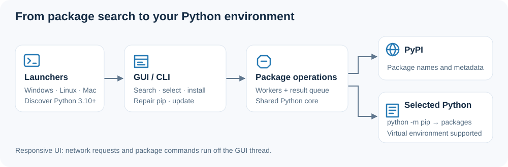

# PyPack

<p align="center"></p>

A compact Python package manager. Search PyPI, check one or several packages, then install them. Fix pip or update installed packages from the same window.

## Download

The latest published release is **0.1.1**. **0.2.0** is prepared and adds the installed-package view, per-package upgrade and uninstall described below; those are not in 0.1.1.

Choose **one** file for your operating system from the [latest release](https://github.com/4Raisan/PyPack/releases/latest):

| Platform | Download | Start |
| --- | --- | --- |
| Windows 64-bit | [PyPack.exe](https://github.com/4Raisan/PyPack/releases/latest/download/PyPack.exe) | Double-click the executable. |
| Linux or macOS | [PyPack.sh](https://github.com/4Raisan/PyPack/releases/latest/download/PyPack.sh) | Run `sh PyPack.sh` in a terminal. |
| macOS alternative | [PyPack.command](https://github.com/4Raisan/PyPack/releases/latest/download/PyPack.command) | Run `chmod +x PyPack.command`, then double-click. |

Each launcher contains the application and square icon. You do not need the source files, a separate logo, or the `.bat`/`.ps1` helpers to use these downloads. Windows bundles its Python-install helper and Tcl/Tk GUI runtime; it detects Python 3.10+ or offers to install/select it when missing. Linux/macOS require Python 3.10+ and tkinter.

## Use

1. Open PyPack and search for a package, such as `panda`.
2. Check the packages you want to install.
3. Click **Install** and follow the Activity log.

The window starts compact; the empty results table takes no space. Activity shows the exact Python interpreter receiving packages. Opening PyPack does not upgrade packages automatically.

Search corrects mistyped names, so `numpi` finds numpy and `reqeusts` finds requests. Each result shows its 30-day download count, and names outside the published top-download list are highlighted in amber. Check package names carefully: popularity and spelling suggestions do not establish that a package is safe.

**Stop** cancels a running install or upgrade and attempts to stop the pip process tree; closing the window also requests cancellation. After installing or upgrading, PyPack runs `pip check` and reports any dependency conflicts.

**Installed** lists everything in the target environment with its version. Check rows to **Upgrade** just those packages, or **Uninstall** them (PyPack asks first). `pip`, `setuptools` and `wheel` are shown greyed out and cannot be checked for removal, because pip needs them to keep working.

Activate a virtual environment before launching to use it, or click **New venv** to create one and switch to it without leaving the window. OS-managed Python and read-only `site-packages` both require a virtual environment; PyPack detects each and says so. You can also set `PYPACK_PYTHON` to a Python executable path. Package installs/upgrades can change that environment's dependencies.

Activity is also written to a rotating log, which is useful because the Windows executable hides its console: `%LOCALAPPDATA%\PyPack\logs\pypack.log`, `~/Library/Application Support/PyPack/logs/pypack.log` on macOS, and `~/.local/share/pypack/logs/pypack.log` on Linux.

## How it works



## Run from source

Keep `pypack_setup.py`, `PyPack-Setup.bat`, `pypack-bootstrap.ps1`, `pypack-setup.sh`, and `assets` together. On Windows, double-click `PyPack-Setup.bat`; on Linux/macOS, run `sh pypack-setup.sh`.

```text
python pypack_setup.py --gui
python pypack_setup.py search panda
python pypack_setup.py install pandas pillow
python pypack_setup.py uninstall pillow
python pypack_setup.py list
python pypack_setup.py fix
python pypack_setup.py update-all
python pypack_setup.py --version
python pypack_setup.py --help
```

`search` and `list` print JSON, so they can be piped to other tools. Exit codes: 0 success, 1 operational failure, 2 invalid arguments. `--gui --update` explicitly upgrades packages at startup.

## Verification

Run `python -m unittest discover -s tests -v` for 108 offline checks covering command routing, interpreter selection, protected and read-only environments, install/upgrade/uninstall failures, cancellation, search ranking and caching, and release packaging. The GUI tests drive the real tkinter window — search, the installed view, checkboxes, install, upgrade, uninstall confirmation, Stop, and virtual-environment creation — with simulated package operations. Nothing installs or upgrades a package, and no test contacts PyPI.

GitHub Actions runs these checks on Windows, Linux and macOS with Python 3.10 and 3.14, using a virtual display on Linux so the window is exercised on every platform.

The release workflow builds the Windows executable, checks its bundled icon and Tcl/Tk with an external target Python, attests build provenance for every asset, and checks standalone Unix argument forwarding and exit codes.

A native desktop session and clean-machine Python installation still require manual validation. The Windows executable is unsigned — see [SECURITY.md](SECURITY.md) for how to verify a download against its checksum and provenance attestation. Script files use the operating system's default file icon; the running app displays the PyPack logo.

## Build downloads

Run `python scripts/build_release.py` to generate the Unix launchers, source ZIP and checksums in `dist/`. On Windows, install `requirements-build.txt` into a dedicated environment and add `--windows` to build the executable. Generated downloads are kept in GitHub Releases, outside the current source tree. Existing v0.1.0 downloads remain available.

See the [development and release guide](docs/DEVELOPMENT.md) for build commands and the checked draft-release workflow.

Built with [PyInstaller](https://pyinstaller.org/en/stable/usage.html). [MIT licensed](LICENSE).
